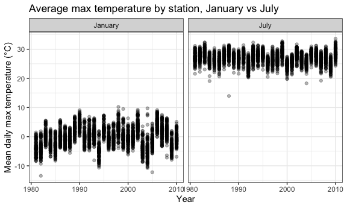
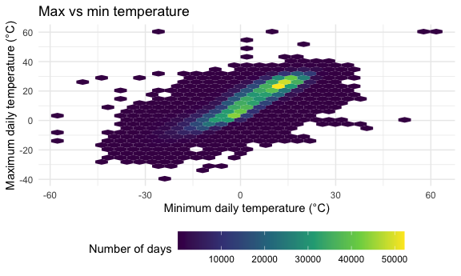
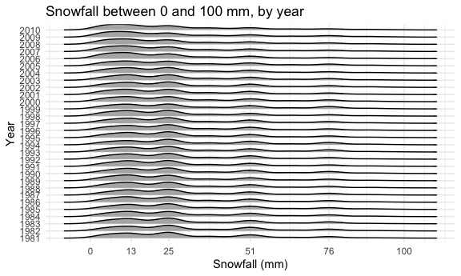
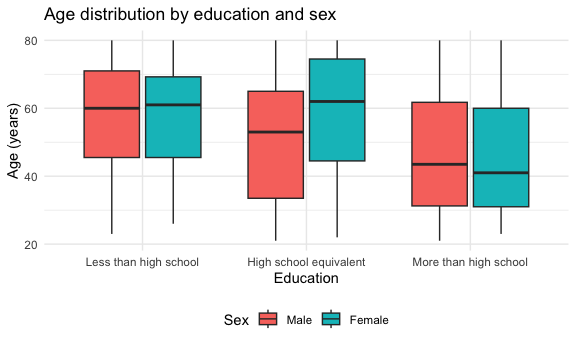

p8105_hw3_ADV2123
================
Andrea Vasquez
2026-10-11

- [PROBLEM 1:](#problem-1)
  - [1.1 Evaluating data set](#11-evaluating-data-set)
  - [1.2 Data cleaning](#12-data-cleaning)
  - [1.3 Two-panel plot: Mean tmax per
    year](#13-two-panel-plot-mean-tmax-per-year)
  - [1.4a Two-panel plot: tmax vs
    tmin](#14a-two-panel-plot-tmax-vs-tmin)
  - [1.4b Two-panel plot: Snowfall per
    year](#14b-two-panel-plot-snowfall-per-year)
- [PROBLEM 2:](#problem-2)
  - [Data import + cleaning](#data-import--cleaning)

``` r
library(tidyverse)
library(patchwork)

knitr::opts_chunk$set(
  fig.width = 6,
  fig.asp = .6,
  out.width = "90%"
)

theme_set(theme_minimal() + theme(legend.position = "bottom"))

options(
  ggplot2.continuous.colour = "viridis",
  ggplot2.continuous.fill = "viridis"
)
```

# PROBLEM 1:

### 1.1 Evaluating data set

``` r
library(p8105.datasets)
data("ny_noaa")

ny_noaa
```

    ## # A tibble: 2,595,176 × 7
    ##    id          date        prcp  snow  snwd tmax  tmin 
    ##    <chr>       <date>     <int> <int> <int> <chr> <chr>
    ##  1 US1NYAB0001 2007-11-01    NA    NA    NA <NA>  <NA> 
    ##  2 US1NYAB0001 2007-11-02    NA    NA    NA <NA>  <NA> 
    ##  3 US1NYAB0001 2007-11-03    NA    NA    NA <NA>  <NA> 
    ##  4 US1NYAB0001 2007-11-04    NA    NA    NA <NA>  <NA> 
    ##  5 US1NYAB0001 2007-11-05    NA    NA    NA <NA>  <NA> 
    ##  6 US1NYAB0001 2007-11-06    NA    NA    NA <NA>  <NA> 
    ##  7 US1NYAB0001 2007-11-07    NA    NA    NA <NA>  <NA> 
    ##  8 US1NYAB0001 2007-11-08    NA    NA    NA <NA>  <NA> 
    ##  9 US1NYAB0001 2007-11-09    NA    NA    NA <NA>  <NA> 
    ## 10 US1NYAB0001 2007-11-10    NA    NA    NA <NA>  <NA> 
    ## # ℹ 2,595,166 more rows

The dataset is structurally tidy and has 2595176 rows and 7 columns,
with one row per station per day, from 747 NY weather stations between
1981-01-01 and 2010-12-31. Key variables are precipitation (`prcp`),
snowfall (`snow`), snow depth (`snwd`), and daily max/min temperature
(`tmax`, `tmin`). Missing data is a substantial issue, particularly for
temperature: `tmax` is missing in about 44% of rows, largely because
many stations do not record temperature, so temperature summaries
reflect only a subset of stations. This could result in average values
that are not representative of the true daily maximum temperature. The
same issue applied to `tmin`. The rest of the variables also have
missing values, although to lesser degree.

### 1.2 Data cleaning

``` r
ny_noaa_df =
  ny_noaa |>
  separate(date, into = c("year", "month", "day"), sep = "-", convert = TRUE) |>
  mutate(
    month = month.name[month] |> 
    factor(levels = month.name),
    prcp = prcp / 10,
    tmax = as.numeric(tmax) / 10,
    tmin = as.numeric(tmin) / 10
  )

ny_noaa_df
```

    ## # A tibble: 2,595,176 × 9
    ##    id           year month      day  prcp  snow  snwd  tmax  tmin
    ##    <chr>       <int> <fct>    <int> <dbl> <int> <int> <dbl> <dbl>
    ##  1 US1NYAB0001  2007 November     1    NA    NA    NA    NA    NA
    ##  2 US1NYAB0001  2007 November     2    NA    NA    NA    NA    NA
    ##  3 US1NYAB0001  2007 November     3    NA    NA    NA    NA    NA
    ##  4 US1NYAB0001  2007 November     4    NA    NA    NA    NA    NA
    ##  5 US1NYAB0001  2007 November     5    NA    NA    NA    NA    NA
    ##  6 US1NYAB0001  2007 November     6    NA    NA    NA    NA    NA
    ##  7 US1NYAB0001  2007 November     7    NA    NA    NA    NA    NA
    ##  8 US1NYAB0001  2007 November     8    NA    NA    NA    NA    NA
    ##  9 US1NYAB0001  2007 November     9    NA    NA    NA    NA    NA
    ## 10 US1NYAB0001  2007 November    10    NA    NA    NA    NA    NA
    ## # ℹ 2,595,166 more rows

The cleaned data now has the corresponding variables for year, month,
and day, as well as the correct units for precipitation and temperature
(tenths of mm and degress of C, respectively). I reorganized

###### 1.2a Most commonly observed values of snowfall

``` r
ny_noaa_df |>
  count(snow, sort = TRUE) |>
  head(6) |>
  knitr::kable()
```

| snow |       n |
|-----:|--------:|
|    0 | 2008508 |
|   NA |  381221 |
|   25 |   31022 |
|   13 |   23095 |
|   51 |   18274 |
|   76 |   10173 |

The most commonly observed values for snowfall is 0 (2,008,508),
followed by NA, 25, 13, 51, and 76. This indicates that, overall, it
does not snow on most days.

### 1.3 Two-panel plot: Mean tmax per year

``` r
mean_tmax_vs_year_plot =
ny_noaa_df |>
  filter(month %in% c("January", "July")) |>
  drop_na(tmax) |>
  group_by(id, year, month) |>
  summarise(mean_tmax = mean(tmax, na.rm = TRUE), .groups = "drop_last") |>
  ggplot(aes(x = year, y = mean_tmax, group = id)) +
  theme_bw() +
  geom_point( alpha = 0.3) +
  facet_grid(. ~ month) +
  labs(
    title = "Average max temperature by station, January vs July",
    x = "Year",
    y = "Mean daily max temperature (°C)"
  )

mean_tmax_vs_year_plot
```



Average maximum temperatures are much higher in July (station means
mostly between 20 and 33 °C) than in January (mostly between -10 and 10
°C). January is also more variable, both across stations within a year
and from year to year. Within each month, stations tend to move
together, meaning that in a cold year, such as January 1994 or 2004,
nearly all stations are colder than usual, which suggests statewide
weather patterns rather than station-specific effects. There is no clear
long-term trend in either month over the 30 years.

There are several outliers. In January, individual stations were
noticeably colder than the rest of the state in 1982 (-13 °C), 1993, and
2005, while in 2004 a few stations were much warmer than the rest (7 to
10 °C when most were below 0 °C). In July, the outliers are mostly on
the cold side: one station averaged 14 °C in 1988, and another averaged
19 °C in 1984, when the other stations ranged up to about 29 °C.

### 1.4a Two-panel plot: tmax vs tmin

``` r
tmax_tmin_plot =
  ny_noaa_df |>
  drop_na(tmin, tmax) |>
  ggplot(aes(x = tmin, y = tmax)) +
  geom_hex() +
  labs(
    title = "Max vs min temperature",
    x = "Minimum daily temperature (°C)",
    y = "Maximum daily temperature (°C)",
    fill = "Number of days"
  ) +
  theme(legend.key.width = unit(1.5, "cm"))

tmax_tmin_plot 
```



The plot shows hexagons, each of which represents the number of
station-days with that combination of minimum and maximum temperature,
with lighter colors indicating more days. The plot shows a positive
association between the two, meaning that days with higher minimum
temperatures also tend to have higher maximum temperatures, forming an
ascending diagonal band. Observations are concentrated in two areas, one
around a minimum of 12–15 °C and a maximum of 24–27 °C (typical summer
days), and one around a minimum of -3 °C and a maximum of 3 °C (typical
winter days). There are a few suspicious values, likely resulting from
recording error. For example, some days have maximum and minimum
temperatures of 60 °C, and some have a minimum temperature higher than
the maximum.

### 1.4b Two-panel plot: Snowfall per year

``` r
snow_plot =
  ny_noaa_df |>
  filter(snow > 0, snow < 100) |>
  mutate(year = factor(year)) |>
  ggplot(aes(x = snow, y = year)) +
  ggridges::geom_density_ridges(scale = .85) +
  scale_x_continuous(breaks = c(0, 13, 25, 51, 76, 100)) +
  labs(
    title = "Snowfall between 0 and 100 mm, by year",
    x = "Snowfall (mm)",
    y = "Year"
  )

snow_plot
```

    ## Picking joint bandwidth of 3.76



The plot shows the distribution of snowfall values between 0 and 100 mm
for each year, with year treated as a categorical variable and the
density curves stacked on top of each other from 1981 to 2010. The
distributions look very similar from year to year. Rather than being
smooth, each ridge has distinct peaks, the largest at around 13 and 25
mm, with smaller peaks at around 51 and 76 mm.

# PROBLEM 2:

### Data import + cleaning

``` r
demo_df =
  read_csv("data/nhanes_covar.csv", skip = 4, na = c("NA", ".", "")) |>
  janitor::clean_names() |>
  filter(age >= 21) |>
  drop_na() |>
  mutate(
    sex = factor(sex, levels = c(1, 2), labels = c("Male", "Female")),
    education = factor(
      education,
      levels = c(1, 2, 3),
      labels = c("Less than high school", "High school equivalent", "More than high school")
    )
  )
```

    ## Rows: 250 Columns: 5
    ## ── Column specification ────────────────────────────────────────────────────────
    ## Delimiter: ","
    ## dbl (5): SEQN, sex, age, BMI, education
    ## 
    ## ℹ Use `spec()` to retrieve the full column specification for this data.
    ## ℹ Specify the column types or set `show_col_types = FALSE` to quiet this message.

``` r
accel_df =
  read_csv("data/nhanes_accel.csv") |>
  janitor::clean_names() |>
  pivot_longer(
    min1:min1440,
    names_to = "minute",
    names_prefix = "min",
    names_transform = as.numeric,
    values_to = "mims"
  )
```

    ## Rows: 250 Columns: 1441
    ## ── Column specification ────────────────────────────────────────────────────────
    ## Delimiter: ","
    ## dbl (1441): SEQN, min1, min2, min3, min4, min5, min6, min7, min8, min9, min1...
    ## 
    ## ℹ Use `spec()` to retrieve the full column specification for this data.
    ## ℹ Specify the column types or set `show_col_types = FALSE` to quiet this message.

``` r
nhanes_df =
  inner_join(demo_df, accel_df, by = "seqn")
```

##### Table of \# men and women per educational category

``` r
demo_df |>
  count(education, sex) |>
  pivot_wider(names_from = sex, values_from = n) |>
  knitr::kable()
```

| education              | Male | Female |
|:-----------------------|-----:|-------:|
| Less than high school  |   27 |     28 |
| High school equivalent |   35 |     23 |
| More than high school  |   56 |     59 |

The numbers of men and women are similar in the “Less than high school”
and “More than high school” categories, but there are more men than
women in the “High school equivalent” category (35 vs. 23).

##### Age Distribution by Education and Sex plot

``` r
Age_by_Edu_sex_plot =
demo_df |>
  ggplot(aes(x = education, y = age, fill = sex)) +
  geom_boxplot() +
  labs(
    title = "Age distribution by education and sex",
    x = "Education",
    y = "Age (years)",
    fill = "Sex"
  )

Age_by_Edu_sex_plot
```



The age distributions show that participants with more than a high
school education tend to be younger, with median ages in the low 40s for
both men and women, compared with a median of around 60 for those with
less than a high school education. Within the “Less than high school”
and “More than high school” categories, the age distributions of men and
women are similar. The “High school equivalent” category is the
exception: women in this group are older than men, with a median age of
about 62 compared with 53, and their middle 50% of ages is shifted
upward (skewed to the right).
